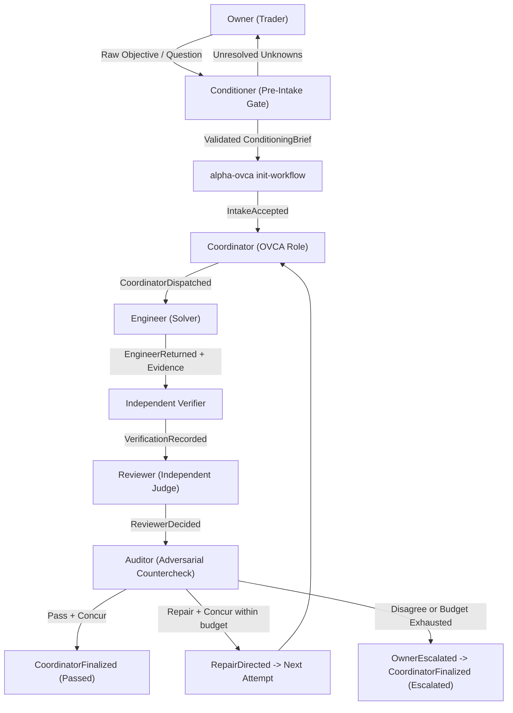

# Alpha_mining System Architecture

`Alpha_mining` serves as the central **Quant Research, Engineering, and Agent Governance Hub**, combining:

1. **Conditioner Governance Layer**: Pre-intake problem framing, falsifiable hypothesis gating, epistemic claim taxonomy, Solver-vs-Verifier isolation, and Thai-first critical-thinking interaction.
2. **OVCA v1.0 Control Plane (`ovca-reference`)**: Deterministic workflow event reduction (`ovca-workflow::WorkflowReducer`) and versioned data contracts (`ovca-types`) pinned via Cargo git dependency (`rev = "5b0726ceddc5c92ccf334e6ef94ba9875ce0c5f4"`).
3. **Quant & Systems Domain Boundaries**: Strict separation between `research`, `strategy`, `execution`, `risk`, and `accounting`.

## System Flow

## Component Boundaries

| Component | Path | Responsibility | Explicit Non-Responsibilities |
|---|---|---|---|
| **Role Charter** | `AGENTS.md`, `roles/` | Defines Conditioner principles, research gates, and OVCA role isolation | Does not execute code or certify results |
| **Conditioner + OVCA CLI** | `rust/crates/alpha-ovca` | Validates `ConditioningBrief`, emits `IntakeAccepted`, replays/verifies/appends `WorkflowEvent` streams via `ovca-workflow` | Does not authenticate actors, run backtests, or prove market edge |
| **Python Hub Bridge** | `python/alpha_mining/control_plane/` | Constructs briefs/events in Python and delegates deterministic validation to `alpha-ovca` | Never reimplements a divergent workflow state machine |
| **Quant Domain Layers** | `python/alpha_mining/{research,strategy,execution,risk,accounting}/` | Separates hypothesis testing, signal logic, order routing, risk limits, and PnL/cost reconciliation | Research never submits orders; Execution never alters risk limits |
| **Workflow Ledger** | `workflows/{templates,examples,runs}/` | Stores conditioning templates, synthetic fixtures, and reproducible run logs (including negative results) | Synthetic fixtures never represent live trading performance |

## Security & Epistemic Boundaries

Inherited from `ovca-reference` (`docs/security-boundary.md` and `docs/limitations.md`):
- `WorkflowReducer` verifies structural, referential, sequence, and budget invariants of caller-supplied events; it does not verify external ground truth or cryptographic actor identity.
- Passing OVCA review/audit proves **workflow conformance**, NOT statistical significance or live trading profitability.
- Quant profitability claims require empirical Out-of-Sample evidence, transaction cost modeling, and leakage/multiple-testing controls recorded outside the schema metadata.
