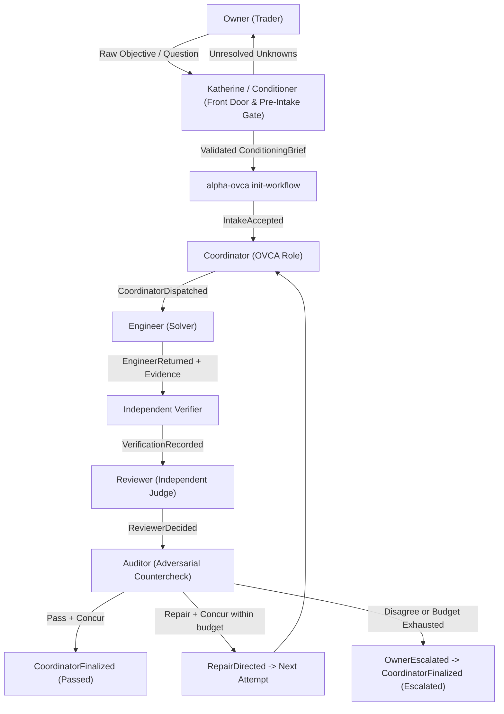

# Alpha_mining System Architecture

`Alpha_mining` serves as the central **Quant Research, Engineering, and Agent Governance Hub**, combining:

1. **Katherine (Conditioner) Governance Layer**: Pre-intake problem framing, Katherine Front Door doctrines, falsifiable hypothesis gating, epistemic claim taxonomy, Solver-vs-Verifier isolation, and Thai-first critical-thinking interaction.
2. **OVCA v1.0 Control Plane (`ovca-reference`)**: Deterministic workflow event reduction (`ovca-workflow::WorkflowReducer`) and versioned data contracts (`ovca-types`) pinned via Cargo git dependency (`rev = "5b0726ceddc5c92ccf334e6ef94ba9875ce0c5f4"`).
3. **Quant & Systems Domain Boundaries**: Strict separation between `research`, `strategy`, `execution`, `risk`, and `accounting`.

## System Flow

## Component Boundaries

| Component | Path | Responsibility | Explicit Non-Responsibilities |
|---|---|---|---|
| **Role Charter** | `AGENTS.md`, `CLAUDE.md` (1:1 mirror), `GEMINI.md`, `roles/` | Defines Katherine Identity Lock, Conditioner principles, research gates, and OVCA role isolation | Does not execute code or certify results |
| **Conditioner + OVCA CLI** | `rust/crates/alpha-ovca` | Validates `ConditioningBrief`, `AdmissionPolicy` canonical SHA-256 `policy_version`, `AuthorizationMandate` binding/revalidation, and `FollowUpDecision`/`HandbackRecord`, while replaying/verifying/appending `WorkflowEvent` streams via `ovca-workflow` | Does not authenticate actors crypto-graphically, run backtests, or prove market edge |
| **Python Hub, Admission & PR Audit** | `python/alpha_mining/control_plane/` | Bridges Python to `alpha-ovca`, manages 2-layer GitHub Rulesets, validates `AGENT_ACK`, evaluates `off \| observe \| auto` proactive admission rules (`admission.py`), and runs multi-PR Semantic Conflict Audits | Never reimplements OVCA state reduction; never mints Mandates in `observe` mode or bypasses Rulesets |
| **Quant Domain Layers** | `python/alpha_mining/{research,strategy,execution,risk,accounting}/` | Separates hypothesis testing, signal logic, order routing, risk limits, and PnL/cost reconciliation | Research never submits orders; Execution never alters risk limits |
| **Hybrid Data & State Vault** | `python/alpha_mining/storage/`, `workflows/vault_manifests/`, `config/storage/drive_vault.json` | Tracks deterministic SHA-256 manifests in Git, hydrates hot Actions Cache (<= 10 GB), and syncs compressed payloads to Google Drive `Alpha_mining_Vault` | Never commits large binary/Parquet datasets directly to Git |
| **Workflow Ledger & Templates** | `workflows/{templates,examples,runs,admission_ledger}/` | Stores conditioning templates, `AGENT_ACK` disclosure template, synthetic fixtures, `DecisionRecord` observe logs, and reproducible run logs | Synthetic fixtures never represent live trading performance |

## GitHub Control Plane, Admission Gate & Hybrid State Layer

1. **2-Layer `main` Ruleset ([config/github/rulesets/](../config/github/rulesets/))**:
   - **Standard (`standard-main-protection`)**: Blocks `deletion` and `non_fast_forward`; enforces PRs, stale-review dismissal, and thread resolution (`required_approving_review_count: 0` until a separate Reviewer App/Bot is registered to avoid GitHub self-approval deadlock).
   - **Details (`alpha-mining-details-main-protection`)**: Enforces `strict_required_status_checks_policy: true` with exact CI checks `rust` and `python` (`integration_id: 15368`).
2. **Separate Reviewer Bot (`ovca-reviewer-bot.yml`)**: Runs cleanly on `workflow_run` / `workflow_dispatch` (checking out `main` only), executes `scripts/pr_audit.py`, posts the semantic audit table, and issues App approvals once `OVCA_REVIEWER_APP_ID` + `OVCA_REVIEWER_APP_PRIVATE_KEY` are configured ([docs/bot-account-setup.md](bot-account-setup.md)).
3. **3-Tier State & Quant Data Vault**:
   - **Git SSOT**: `workflows/vault_manifests/<artifact_id>.manifest.json` (SHA-256 + `cache_key`)
   - **Hot Cache**: `.vault_cache/` & `actions/cache@v4` (CI Cargo/vault hydration)
   - **Master Vault (Google Drive `Alpha_mining_Vault`, ID `1uB0PU8GvrCx5payhEufdkxFXuWf4RGFp`)**: `datasets/` (`12q4OVX65a0R1fubWJuey5kqkXUNoDXsX`), `backtests/` (`1mSUfgnR4yNhSi3ggM_DYHMjP9ynB5Yxr`), `state_snapshots/` (`11LgT2EI6OrjeBoF8y91Smz2wEfRwfxbt`), synchronized via `scripts/vault_sync.py` and `.github/workflows/vault-sync.yml`.
4. **Mandate (`Context ≠ Authority`) & Observe Mode Gate ([admission_policy.json](../config/governance/admission_policy.json))**:
   - **Immutable `AuthorizationMandate`**: Separates incoming thread/context delivery from execution authority (`explicit` vs `inferred`), pins canonical `policy_version`, enforces segment-safe `writable_scope` containment against `ConditioningBrief.authority.scope`, and routes out-of-scope human follow-ups to `handback`.
   - **Read-Only Observe Mode (`admission-observe.yml`)**: Evaluates `ci-default-branch-failure`, `parallel-pr-semantic-conflict`, and `quant-manifest-drift-check` on completed CI runs from trusted `main`, separates `unavailable` from `ignore`, and uploads JSONL/Markdown `would_accept` reports to Actions artifacts without mutating the repo.

## Security & Epistemic Boundaries

Inherited from `ovca-reference` (`docs/security-boundary.md` and `docs/limitations.md`):
- `WorkflowReducer` verifies structural, referential, sequence, and budget invariants of caller-supplied events; it does not verify external ground truth or cryptographic actor identity.
- Passing OVCA review/audit proves **workflow conformance**, NOT statistical significance or live trading profitability.
- Quant profitability claims require empirical Out-of-Sample evidence, transaction cost modeling, and leakage/multiple-testing controls recorded outside the schema metadata.
